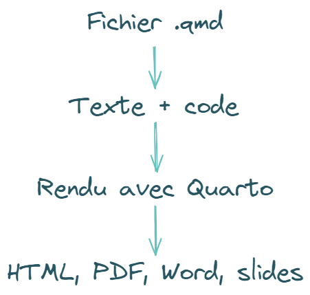
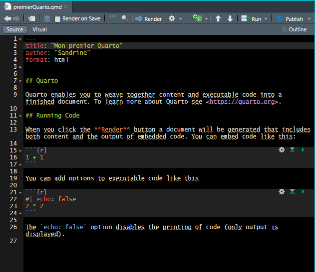
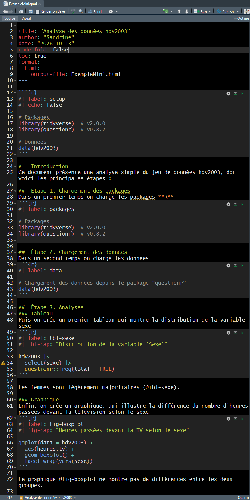
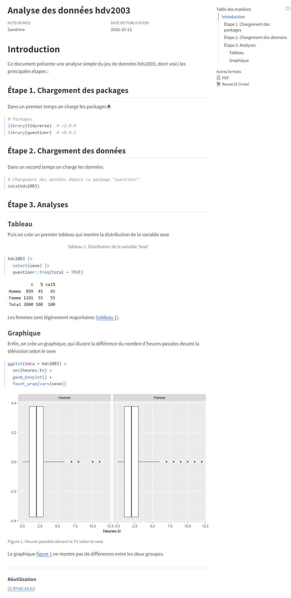

```{r}
#| label: initR
#| eval: true
#| include: false
#| echo: false

#   ____________________________________________________________________________
#   R version                                                               ####
#   R version 4.6.0 (2026-04-24 ucrt) -- "Because it was There"

#   ____________________________________________________________________________
#   Chargement des packages                                                 ####
library(tidyverse)    # v2.0.0
library(questionr)    # v0.8.2
library(knitr)        # v1.51
library(kableExtra)   # 1.4.1 # pour scroll_box
library(fontawesome)  # v0.5.3

sessioninfo::session_info() -> sessionInfo # alternative à utils::sessionInfo()

#   ____________________________________________________________________________
#   Chargement des données utilisées pour cette session                     ####
data(hdv2003)

#   ____________________________________________________________________________
#   Fonction pour n'afficher que quelques lignes de l'output des chunks     ####
## Source : https://forum.posit.co/t/showing-only-the-first-few-lines-of-the-results-of-a-code-chunk/6963
hook_output <- knit_hooks$get("output")
knit_hooks$set(output = function(x, options) {
   lines <- options$output.lines
   if (is.null(lines)) {
     return(hook_output(x, options))  # pass to default hook
   }
   x <- unlist(strsplit(x, "\n"))
   more <- "..."
   if (length(lines) == 1) {        # first n lines
     if (length(x) > lines) {
       # truncate the output, but add ....
       x <- c(head(x, lines), more)
     }
   } else {
     x <- c(more, x[lines], more)
   }
   # paste these lines together
   x <- paste(c(x, ""), collapse = "\n")
   hook_output(x, options)
 })
```

# {.unlisted .unnumbered}

## Jeu de données utilisé dans cette session {.unnumbered background-color="#dfddec"}

:::: columns
::: {.column width="30%"}
**`hdv2003`**

- disponible dans le package [`{questionr}`](https://juba.github.io/questionr/index.html)
- échantillon tiré de l'enquête Histoire de vie, réalisée en 2003 en France, par l'Insee, auprès de la population âgée de 18 ans et plus
- 2000 lignes et 20 variables
:::

::: {.column width="5%"}
:::

::: {.column width="65%"}
**Dictionnaire des variables**

```{r}
#| label: hdv
#| eval: true
#| include: true
#| message: false
#| echo: false

variables <- c("id"
               , "age"
               , "sexe"
               , "nivetud"
               , "poids"
               , "occup"
               , "qualif"
               , "freres.soeurs"
               , "clso"
               , "relig"
               , "trav.imp"
               , "trav.satisf"
               , "hard.rock"
               , "lecture.bd"
               , "peche.chasse"
               , "cuisine"
               , "bricol"
               , "cinema"
               , "sport"
               , "heures.tv")

descriptions <- c("Identifiant unique de l'individu"
                  , "Âge de l'individu"
                  , "Sexe de l'individu"
                  , "Niveau d'études"
                  , "Poids de l'individu dans l'échantillon"
                  , "Occupation principale"
                  , "Qualification professionnelle"
                  , "Nombre de frères et soeurs"
                  , "Classe sociale"
                  , "Religion"
                  , "Importance accordée au travail"
                  , "Satisfaction au travail"
                  , "Écoute du hard rock"
                  , "Lecture de bandes dessinées"
                  , "Pratique de la pêche ou de la chasse"
                  , "Pratique de la cuisine"
                  , "Pratique du bricolage"
                  , "Fréquentation du cinéma"
                  , "Pratique d'un sport"
                  , "Nombre d'heures passées devant la télévision")

types <- c("entier"
           , "entier"
           , "facteur (Femme, Homme)"
           , "facteur (8 modalités)"
           , "numérique"
           , "facteur (7 modalités)"
           , "facteur (7 modalités)"
           , "entier"
           , "facteur (3 modalités)"
           , "facteur (6 modalités)"
           , "facteur (4 modalités)"
           , "facteur (3 modalités)"
           , "facteur (Oui, Non)"
           , "facteur (Oui, Non)"
           , "facteur (Oui, Non)"
           , "facteur (Oui, Non)"
           , "facteur (Oui, Non)"
           , "facteur (Oui, Non)"
           , "facteur (Oui, Non)"
           , "numérique"
)

data.frame(Variable = variables
                 , Description = descriptions
                 , Type = types) -> df
df |> 
  kable() |> 
  kable_paper("hover", full_width = F) |> 
  scroll_box(height = "550px")
```
:::
::::

#    Introduction générale

##   Le problème de départ...

Une étude contient

- le code qui transforme les données  
- les tableaux et graphiques produits  
- le texte qui explique les résultats  
- le rapport ou la présentation à partager  

`r fontawesome::fa("circle-exclamation", fill = "#A626A4")` **Quand ces éléments sont séparés, il faut les mettre à jour manuellement et vérifier qu'ils racontent toujours la même histoire**

##   Les questions associées...

- Comment éviter les copier-coller des résultats pour que le document Word corresponde bien aux résultats ?  
- Comment rendre son travail intelligible pour les collègues (et soi-même) ?  
- Comment assurer une certaine reproductibilité du travail ?  
- Comment mettre à disposition du code ?  

`r fontawesome::fa("angles-right", fill = "#A626A4")` **Il existe des outils pour résoudre ces problèmes liés au partage et la reproductibilité du travail**

##   La programmation lettrée

**Idée centrale :** associer dans un même document du code, des explications et des résultats

::::{.columns}
:::{.column width="48%"}

````markdown
Ce script est dédié aux premières analyses des données hdv2003 du package "questionr"

#  Étape 1. Chargement des packages
Dans un premier temps on charge les packages R
  `{r}
  # Packages
  library(tidyverse)  # v2.0.0
  library(questionr)  # v0.8.2
  `

#  Étape 2. Chargement des données
Dans un second temps on charge les données
  `{r}
  # Chargement des données depuis le package "questionr"
  data(hdv2003)
  `

#  Étape 3. Analyses
## Tableau
Puis on crée un premier tableau qui montre la distribution de la variable sexe
  `{r}
  hdv2003 |> 
    select(sexe) |> 
    questionr::freq(total = TRUE)
  `

## Graphique
Enfin, on crée un graphique, qui illustre la différence du nombre d'heures passées devant la télévision selon le sexe
  `{r}
  hdv2003 |> 
  ggplot() +
    aes(heures.tv) + 
    geom_boxplot() + 
    facet_wrap(vars(sexe))
  `
````

:::

:::{.column width="4%"}
:::

:::{.column width="48%"}
- Le texte explique **pourquoi** et **comment** l'analyse est réalisée  
- Le code est exécuté lors du rendu (`Render`)  
- Les sorties, tableaux et graphiques sont insérés automatiquement dans le document final  
- Le document reste lisible sans être un simple script commenté  
- Modifier les données ou le code peut mettre à jour tout le document
:::
::::

##   Programmation classique _vs_ programmation lettrée

|                              | Programmation classique   | Programmation lettrée     |
|:-----------------------------|:--------------------------|:--------------------------|
| Type de fichier              | .R                        | .rmd, .qmd                |
| Organisation des fichiers    | Script et rapport séparés | Code et analyse regroupés |
| Contenu du fichier           | Code prédominant          | Texte prédominant         |
| Documentation                | Brefs commentaires        | Texte explicatif détaillé |
| Lecture                      | Orientée code             | Orientée documentation    |
| Intégration des résultats    | Par copier-coller         | Grâce à la compilation    |
| Mise à jour des tables/plots | Manuelle                  | Lors de la compilation    |
| Reproductibilité             | Limitée                   | Facilitée                 | 

`r fontawesome::fa("angles-right", fill = "#A626A4")` **Quarto applique ce principe de programmation lettrée**

#    Présentation de Quarto

##   Quarto en une idée

::::{.columns}
:::{.column width="48%"}
{width="60%" fig-align="center" fig-alt="Workflow Quarto du document qmd au fichier de sortie."}
:::

:::{.column width="4%"}
:::

:::{.column width="48%"}
Un seul fichier qui rassemble  

- du texte rédigé en **Markdown**  
- du code **R** et/ou dans d'autres langages
- les résultats produits par ce code  

et qui est compilé pour générer un document, un site ou une présentation
:::
::::

`r fontawesome::fa("angles-right", fill = "#A626A4")` **Le fichier source au format `.qmd` est modifiable**  
`r fontawesome::fa("angles-right", fill = "#A626A4")` **Le rendu, qui peut prendre plusieurs formats de sortie, est le résultat prêt à être diffusé et partagé**

##   Utiliser Quarto dans RStudio

###  1. Installer les outils

- Installer [**R**](https://cran.r-project.org/)  
- Installer [**RStudio**](https://posit.co/download/rstudio-desktop/)  
- Installer l'extension **Quarto** dans **RStudio** si nécessaire  

`r fontawesome::fa("circle-info", fill = "#A626A4", prefer_type = "solid")` **RStudio** propose une interface intégrée pour créer, modifier et compiler des documents **Quarto**

---

###  2. Créer un document

::::{.columns}
:::{.column width="48%"}
Dans **RStudio**  

1. **File** → **New File** → **Quarto Document…**  
2. Choisir un titre, un auteur ou une autrice, et éventuellement le format de sortie  
3. Choisir **html**, **pdf**, **Word** ou une présentation  
4. Cliquer sur **Create**  
:::

:::{.column width="4%"}
:::

:::{.column width="48%"}
`r fontawesome::fa("angles-right", fill = "#A626A4")` **RStudio** crée un fichier `.qmd` contenant déjà un YAML, du texte et un exemple de bloc de code

{width="75%" fig-align="center" fig-alt="Aperçu du fichier qmd."}
:::
::::

---

###  3. Compiler (rendre) un document

1. Ouvrir le fichier `.qmd` créé dans **RStudio**  
2. Modifier le titre dans le **YAML**  
3. Cliquer sur **Render**  
4. Consulter le résultat dans l'onglet **Viewer** ou dans le navigateur

<br/>

`r fontawesome::fa("circle-info", fill = "#A626A4", prefer_type = "solid")` Le bouton **Render** exécute le document  

- il lance le code **R**  
- il insère les résultats  
- et il produit le fichier de sortie choisi

##  Le fichier `.qmd`

Un document **Quarto** contient généralement trois types de contenu  

- **Des métadonnées** : titre, format, options  
- **Du texte** : titres, paragraphes, listes, liens  
- **Du code** : blocs **R** exécutés à la compilation (au rendu)  

`r fontawesome::fa("lightbulb", fill = "#A626A4")` **L'extension `.qmd` signifie "Quarto Markdown"**

---

###  Exemple

::::{.columns}
:::{.column width="47%"}
#### Script Quarto (.qmd)

```{r}
#| label: qmd
#| echo: false
#| fig-align: center


```
:::

:::{.column width="6%"}
`r fontawesome::fa("right-long", fill = "#A626A4")` 
:::

:::{.column width="47%"}
#### Rendu en html

```{r}
#| label: html
#| echo: false
#| fig-align: center

# image générée avec 
# webshot2::webshot(url = "E:/GitRepo/bulledr/docs/06-quarto_redecouverte/ExempleMini.html"
#                   , file = here::here("06-quarto_redecouverte/img", "qmd-report-example.png")
#                   , vheight = 1800)  # hauteur de la capture d'écran

```
:::
::::

#    Utiliser Quarto

##   Écrire simplement avec Markdown

- L'écriture sous **Quarto** s'appuie sur la syntaxe **Markdown**   
`r fontawesome::fa("angles-right", fill = "#A626A4")` Les marqueurs **Markdown** sont des conventions simples que **Quarto** transforme à l'affichage  
`r fontawesome::fa("globe", fill = "#A626A4")` [Les bases en **Markdown**](https://quarto.org/docs/authoring/markdown-basics.html)  
- On peut écrire du code, des listes, des tableaux, des liens vers des pages web, des images, etc.  
- Il est également possible de gérer les [citations](https://quarto.org/docs/authoring/citations.html) et les [références croisées](https://quarto.org/docs/authoring/cross-references.html)

*Exemple*  

```markdown
## Une diapositive

Un paragraphe explicatif

- Premier point
- Deuxième point

**Texte en gras** et *texte en italique*
```

<br/>

`r fontawesome::fa("circle-info", fill = "#A626A4", prefer_type = "solid")` **Quarto** reprend les principes de **RMarkdown** mais constitue un système plus général, compatible avec plusieurs langages de programmation (**R**, **Python**, **Julia**, **JavaScript**)

---

###  Syntaxe [**Markdown**](https://www.markdownguide.org/) pour la mise en forme du texte

| Caractéristique | Syntaxe Markdown                     | Résultat                               |
|:----------------|:-------------------------------------|:---------------------------------------|
| italic          | `texte en *italique*`                | texte en *italique*                    |
| bold            | `texte en **gras**`                  | texte en **gras**                      |
| superscript     | `superficie de 200 m^2^`             | superficie de 200 m^2^                 |
| subscript       | `Les individus notés n~i~`           | Les individus notés n~i~               |
| headings        | `# Titre 1`                          | # Titre 1                              |
|                 | `## Titre 2`                         | ## Titre 2                             |
|                 | `### Titre 3`                        | ### Titre 3                            |
|                 | `#### Titre 4`                       | #### Titre 4                           |
|                 | `##### Titre 5`                      | ##### Titre 5                          |
|                 | `###### Titre 6`                     | ###### Titre 6                         |
| links           | Site `[Quarto](https://quarto.org/)` | Site [**Quarto**](https://quarto.org/) |
| visible links   | le lien est `<https://quarto.org/>`  | le lien est <https://quarto.org>       |
| quote           | `> ceci est important à retenir`     | > ceci est important à retenir         |

`r fontawesome::fa("lightbulb", fill = "#A626A4")` **Il n'est pas possible de souligner du texte en Markdown**, le soulignement étant réservé aux liens hypertextes

##   Le YAML 

###  Définir les paramètres du document et du rendu

- Dans un fichier `.qmd`, le bloc YAML se trouve généralement au début du document, entre deux lignes de trois tirets `---`  
- Il donne à **Quarto** des informations sur le document et indique le format de sortie  
  + les métadonnées : titre, auteur, date, langue, etc.  
  + les options sur les formats de sortie : `html`, `pdf`, `word`, `revealjs`, etc.
  + les options de mise en page : table des matières, apparence, etc.

```yaml
---
title: "Découvrir Quarto sous R"
author: "Nom et prénom"
date: "2026-10-13"
lang: fr
format:
  revealjs:
    theme: simple
    slide-number: true
---
```

`r fontawesome::fa("circle-exclamation", fill = "#A626A4")` 
**Le YAML est le premier élément évalué lors de la compilation**  
`r fontawesome::fa("angles-right", fill = "#A626A4")` En cas d'erreur, la compilation s'arrête quasi instantanément


---

###  Écrire le YAML

:::::{.columns}
::::{.column width="47%"}
- `title` : le titre du document
- `author` : le nom de l'auteur ou de l'autrice
- `date` : la date affichée
- `lang` : la langue du document, ici le français
- `format` : le type de sortie demandé
- `revealjs` : des diapositives `html` avec `revealjs`
- `theme` et `slide-number` : des options de présentation

`r fontawesome::fa("circle-exclamation", fill = "#A626A4")` **La syntaxe est très sensible à l'indentation**  
`r fontawesome::fa("angles-right", fill = "#A626A4")` **Ajouter 2 espaces pour chaque niveau d'indentation**  

<br/>

*Dans l'exemple précédent, les options placées sous `revealjs` appartiennent à ce format*
::::

::::{.column width="6%"}
::::

::::{.column width="47%"}
::: {.callout-note appearance="simple" title="Voir la documentation Quarto pour plus d'informations sur les nombreuses options disponibles"}
-   section [Front matter](https://quarto.org/docs/authoring/front-matter.html)  
-   pour le format [HTML](https://quarto.org/docs/reference/formats/html.html)  
-   pour le format [PDF](https://quarto.org/docs/reference/formats/pdf.html)  
-   pour le format [Word](https://quarto.org/docs/reference/formats/docx.html)  
-   pour le format [Revealjs](https://quarto.org/docs/reference/formats/presentations/revealjs.html)  
-   pour le format [Powerpoint](https://quarto.org/docs/reference/formats/presentations/pptx.html)  
:::
::::
:::::

---

###  Personnaliser les rendus

Le YAML permet de régler le thème et le numéro des diapositives, ou encore la création d'une table des matières ou l'utilisation d'une base bibliographique (au format `.bib`)

```yaml
format:
  revealjs:
    theme: simple
    slide-number: true
  pdf: 
    toc: true
bibliography: mon_fichier.bib
```

`r fontawesome::fa("lightbulb", fill = "#A626A4")` Les thèmes prédéfinis incluent notamment `simple`, `dark`, `solarized` et `beige`. Il est possible de créer son propre thème en le personnalisant avec le `css`

`r fontawesome::fa("circle-exclamation", fill = "#A626A4")` Mieux vaut commencer par quelques options utiles et ajouter le reste selon les besoins

---

###  Où placer les réglages YAML ? 

Les réglages **YAML** peuvent être spécifiés dans un fichier séparé pour éviter  

- de répéter dans chaque `.qmd` les options communes au projet  
- un long bloc **YAML** en début de script  

::::{.columns}
:::{.column width="57%"}
`r fontawesome::fa("lightbulb", fill = "#A626A4")` **Règle pratique**  

- les options communes dans `_quarto.yml`  
- les spécificités dans le `.qmd`

<br/>

| Niveau   | Fichier                | Portée                       |
|:---------|:-----------------------|:-----------------------------|
| Document | YAML en tête du `.qmd` | Ce document seulement        |
| Dossier  | `_metadata.yml`        | Documents du dossier         |
| Projet   | `_quarto.yml`          | Tous les documents du projet |

:::

:::{.column width="6%"}
:::

:::{.column width="37%"}
<br/>
<br/>
<br/>

*Exemple*

```yaml
# _quarto.yml
project:
  type: default

format:
  revealjs:
    theme: simple
    slide-number: true

execute:
  echo: true
```
:::
::::

##   Produire un rapport : Word ou pdf

`r fontawesome::fa("lightbulb", fill = "#A626A4")` Le même fichier `.qmd` peut produire une page html, une présentation, un document Word ou un pdf  

`r fontawesome::fa("angles-right", fill = "#A626A4")` **Bonne pratique :** rédiger et maintenir le `.qmd`, puis générer le format selon les besoins 

::::{.columns}
:::{.column width="47%"}

*Exemple*

```yaml
---
title: "Rapport d'analyse"
author: "Nom et prénom"
date: today
lang: fr
format:
  docx:
    toc: true
  pdf:
    toc: true
    number-sections: true
---
```
:::

:::{.column width="6%"}
:::

:::{.column width="47%"}
**Comment lire ce YAML?**  

- `docx` produit un fichier Word modifiable  
- `pdf` produit un document pdf non modifiable
- `toc: true` ajoute une table des matières au document  
- `number-sections: true` numérote les sections dans le pdf  
:::
::::

<br/>

`r fontawesome::fa("code", fill = "#A626A4")` **Commandes à exécuter dans un terminal, pour obtenir le rendu dans un format précis**

```bash
quarto render rapport.qmd --to docx
quarto render rapport.qmd --to pdf
```

`r fontawesome::fa("circle-exclamation", fill = "#FFFFFF")` Le rendu PDF nécessite généralement une distribution **LaTeX**, par exemple **TinyTeX**, pensez à vérifier que c'est installé sur votre machine

##   Créer une diapositive

Avec `revealjs`, 2 balises `#` successives (`##`) créent les diapositives

```markdown
## Première diapositive

Contenu de la première diapositive

## Deuxième diapositive

Contenu de la deuxième diapositive
```

`r fontawesome::fa("lightbulb", fill = "#A626A4")` Une seule balise `#` sert à créer des sections avec une diapositive de titre

##   Ajouter un bloc de code R

- Un bloc **R** exécutable commence par ```` ```{r} ```` et se termine par trois accents graves (_back ticks_)  
- Dans le rendu, **Quarto** peut inclure le code, le résultat, ou les deux selon les options choisies  
- Les options commencent par le _hashpipe_ `#|` et s'écrivent en utilisant la syntaxe : `option: value`

:::::{.columns}
::::{.column width="47%"}
```{r}
#| echo: fenced

# Distribution de la variable "age"
hdv2003 |> 
  select(age) |> 
  summary()
```
::::

::::{.column width="6%"}
::::

::::{.column width="47%"}
`r fontawesome::fa("lightbulb", fill = "#A626A4")` Dans cet exemple, le code et le résultat sont affichés car le bloc de code est écrit avec les options  

- `#| echo: true` pour afficher le code  
- `#| eval: true` pour afficher le résultat  
::::
:::::

:::{.callout-tip appearance="minimal"}
- **R n'est pas le seul langage possible dans les blocs de code**  
`r fontawesome::fa("angles-right", fill = "#A626A4")` On spécifie le langage souhaité dans les accolades {} sur la première ligne du bloc de code, à la suite des ```  
- **Pour afficher directement le résultat d'un calcul dans une phrase, on insère directement le code dans la phrase, en utilisant un seul _back tick_ ` pour encadrer le code**  

  + **Syntaxe** : L'âge moyen des \``{r} hdv2003 |> nrow()`\` observations de hdv2003 est égal à \``{r} hdv2003 |> pull(age) |> mean(na.rm = TRUE)`\`  
  + **Résultat** : L'âge moyen des `{r} hdv2003 |> nrow()` observations de hdv2003 est égal à `{r} hdv2003 |> pull(age) |> mean(na.rm = TRUE)`  

:::

---

###  Paramétrer les blocs de code

Les options des blocs de code s'écrivent avec le préfixe `#|` et permettent de contrôler l'exécution, l'affichage du code et la mise en forme des sorties

| Option                           | Description                                                                                        |
|:---------------------------------|:---------------------------------------------------------------------------------------------------|
| `label`                          | Donner un nom au bloc (utile pour le référencer et y faire appel dans le texte)                    |
| `eval: true/false`               | Exécuter le code du bloc                                                                           |
| `echo: true/false`               | Afficher le code dans le document final                                                            |
| `include: true/false`            | Contrôler l'inclusion du code et/ou des résultats dans le document final (`false` : supprime tout) |
| `warning: true/false`            | Inclure les avertissements générés dans le document final                                          |
| `message: true/false`            | Afficher dans le document final, les messages générés par le code                                  |
: Principales options des blocs de code

---

###  Nommer les blocs de code

Chaque bloc de code peut recevoir un **label**  

- qui doit être un nom composé de chiffres et de lettres, court, explicite et **unique** (les tirets `-` et les _underscores_ `_` sont autorisés, en revanche les espaces et caractères spéciaux sont déconseillés)  
- doit être placé de préférence sur la première ligne du bloc de code, avant les autres options  

<br/>

```{r}
#| label: datahdv
#| echo: fenced
#| eval: true
data(hdv2003)
```

<br/>
`r fontawesome::fa("lightbulb", fill = "#A626A4")` **Il permet d'identifier le bloc dans le document et dans les messages d'erreur** et de faciliter la lecture et la maintenance d'un document long

---

### Cas particulier des blocs de codes des tableaux et figures

#### Référencer tableaux et figures dans le texte

- On donne des noms de labels au bloc de code avec un préfixe spécifique : `tbl-` pour les tableaux ; `fig-` pour les figures (images, graphiques) 
- On peut donner une légende avec les options `#| tbl-cap: ` pour les tableaux ; `#| fig-cap: ` pour les figures
- On fait ensuite référence au tableau ou à la figure avec `@prefixe-nom` dans le texte  

<br/>

::::{.columns}
:::{.column width="30%"}
##### Bloc de code
```{{r}}
#| label: fig-sexeTV-demo
#| fig-height: 2
#| fig-width: 3
#| fig-cap: "Relation entre heures passées devant la TV et sexe des individus."

hdv2003 |> 
  ggplot() +
  aes(x = sexe, y = heures.tv) +
  geom_boxplot()
```
:::

:::{.column width="2%"}
:::

:::{.column width="30%"}
##### Résultat du bloc de code
```{r}
#| echo: false
#| label: fig-sexeTV
#| fig-height: 2
#| fig-width: 3
#| fig-cap: "Relation entre heures passées devant la TV et sexe des individus."

hdv2003 |> 
  ggplot() +
  aes(x = sexe, y = heures.tv) +
  geom_boxplot()
```
:::

:::{.column width="2%"}
:::

:::{.column width="36%"}
##### Référence dans le texte  
`Comme illustré par la @fig-sexeTV, il y a peu de différences entre les groupes`  

##### Rendu
Comme illustré par la @fig-sexeTV, il y a peu de différences entre les groupes 
:::
::::

---

#### Paramétrer le rendu des blocs de code des graphiques R

Plusieurs options permettent d'améliorer le rendu des graphiques **R**

| Option       | Rôle                                               | Exemple                           |
|:-------------|:---------------------------------------------------|:----------------------------------|
| `label`      | Identifie le bloc et permet une référence croisée  | `#| label: fig-age`               |
| `fig-cap`    | Ajoute une légende à la figure                     | `#| fig-cap: "Distribution de la variable 'age'"` |
| `fig-width`  | Définit la largeur, en pouces, de la figure        | `#| fig-width: 7 `                |
| `fig-height` | Définit la hauteur, en pouces, de la figure        | `#| fig-height: 4.5`              |
| `fig-align`  | Définit l'alignement horizontal (`left`, `center` ou `right`)  | `#| fig-align: center`  |
| `fig-alt`    | Ajoute un texte alternatif pour les personnes qui ne peuvent pas voir la figure | `#| fig-alt: "Diagramme en boîte des heures quotidiennes passées devant la télévision selon le sexe"` |
| `dpi`        | Définit la résolution de l'image produite          | `#| dpi: 300`                     |

##   Ajouter des tableaux

Un tableau peut être écrit directement en **Markdown** ou produit par **R**

###  Produire un tableau manuellement
::::{.columns}
:::{.column width="47%"}
- Les tableaux directement écrits en **Markdown** sont  

  + adaptés aux petits tableaux fixes  
  + simples à rédiger et à modifier

- L'alignement dans les cellules est contrôlé avec les `:`  
`r fontawesome::fa("globe", fill = "#A626A4")` Voir la [page d'aide Quarto dédiée](https://quarto.org/docs/authoring/tables.html) pour les options disponibles 

`r fontawesome::fa("triangle-exclamation", fill = "#A626A4")` Les valeurs ne sont pas recalculées lors du rendu
:::

:::{.column width="6%"}
:::

:::{.column width="47%"}
**Syntaxe**

```markdown   
| Colonne 1   | Colonne 2   | Colonne 3   | Colonne 4   |
|:------------|:-----------:|------------:| ----------- |
| Alignement  | Alignement  | Alignement  | Alignement  |
| à gauche    | centré      | à droite    | par défaut  |
: Titre du tableau.
```

**Résultat**

| Colonne 1   | Colonne 2   | Colonne 3   | Colonne 4   |
|:------------|:-----------:|------------:| ----------- |
| Alignement  | Alignement  | Alignement  | Alignement  |
| à gauche    | centré      | à droite    | par défaut  |
: Titre du tableau.

:::
::::

`r fontawesome::fa("circle-question", fill = "#A626A4", prefer_type = "solid")` **Vous ne savez pas comment écrire un tableau en Markdown ?**  
`r fontawesome::fa("angles-right", fill = "#A626A4")` Utilisez [l'outil en ligne](https://www.tablesgenerator.com/markdown_tables)

---

###  Produire un tableau avec R

- Les tableaux produits par un bloc de code **R**  
  + sont recalculés à chaque rendu
  + sont cohérents avec les données et le code
  + peuvent être référencés dans le texte grâce au label `tbl-` 
  + peuvent être décrits par une légende avec l'option `#| tbl-cap:`
  
- Les tableaux sont rendus propres et lisibles grâce à la fonction `kable()` du package {`knitr`}  

```{{r}}
#| label: tbl-hdv
#| tbl-cap: "Extrait des données hdv2003."
hdv2003 |> 
  select(id:qualif) |> 
  slice(1:2) |> 
  knitr::kable()
```

```{r}
#| label: tbl-hdv
#| tbl-cap: "Extrait des données hdv2003."
#| echo: false
hdv2003 |> 
  select(id:qualif) |> 
  slice(1:2) |> 
  knitr::kable()
```


##   Ajouter une image

Une image non générée directement dans un bloc de code **R** peut être insérée directement en **Markdown** avec la syntaxe suivante  
``   

- le texte écrit dans les crochets est la légende de l'image  
- le chemin indiqué dans les parenthèses est relatif au fichier `.qmd`  
`r fontawesome::fa("lightbulb", fill = "#A626A4")` **Prévoir dans le projet un dossier qui stocke les images, pour faciliter l'organisation** (par exemple, `img/` comme ici pour cette présentation)

<br/>

::::{.columns}
:::{.column width="47%"}
**Syntaxe Markdown**  
``  
:::

:::{.column width="6%"}
:::

:::{.column width="47%"}
**Résultat**  


:::
::::

##   Ajouter une équation

L'écriture d'équations mathématiques est possible avec la syntaxe **LaTeX**  

- en ligne en encadrant l'équation par `$`
- en "bloc", centré au milieu de la page, en encadrant l'équation par `$$`

<br/>

::::{.columns}
:::{.column width="47%"}
###  Équation au sein d'un texte

**Syntaxe**
```markdown        
La célèbre équation d'Einstein est $E = mc^2$.
```

**Résultat**  
La célèbre équation d'Einstein est $E = mc^2$.
:::

:::{.column width="6%"}
:::

:::{.column width ="47%"}
###  Équation en bloc

**Syntaxe**
```markdown   
La célèbre équation d'Einstein est 

$$
E = mc^2
$$
```

**Résultat**  
La célèbre équation d'Einstein est  
$$
E = mc^2
$$
:::
::::

#    À retenir

##   En résumé

Les différents éléments pour utiliser **Quarto** sous **R**  

- `.qmd` : le fichier source **Quarto**  
- **YAML** : les métadonnées et réglages du document  
- **Markdown** : la structure et le texte  
- Blocs **R** : le code exécuté et ses résultats  
- `render` : la commande qui produit la présentation

#    Ressources

##   Pour aller plus loin

De nombreuses ressources en ligne

`r fontawesome::fa("globe", fill = "#A626A4")` [Tutoriel **Markdown**](https://www.markdowntutorial.com/fr/)  
`r fontawesome::fa("globe", fill = "#A626A4")` [Tutoriel **Quarto**](https://quarto.org/docs/get-started/hello/rstudio.html)  
`r fontawesome::fa("globe", fill = "#A626A4")` [Documentation Quarto : présentations](https://quarto.org/docs/presentations/)  
`r fontawesome::fa("globe", fill = "#A626A4")` [Guide Quarto pour Reveal.js](https://quarto.org/docs/presentations/revealjs/)  
`r fontawesome::fa("globe", fill = "#A626A4")` [Documentation Quarto : options d’exécution](https://quarto.org/docs/computations/execution-options/)  
`r fontawesome::fa("globe", fill = "#A626A4")` [Documentation Quarto : projets et `_quarto.yml`](https://quarto.org/docs/projects/quarto-projects.html)  
et plus encore dans la `r fontawesome::fa("globe", fill = "#A626A4")` [documentation officielle **Quarto**](https://quarto.org/)  

<!-- quarto render 06-quarto_redecouverte/index.qmd --to html -->
<!-- quarto render 06-quarto_redecouverte/index.qmd --to inrae-revealjs -->
<!-- quarto render 06-quarto_redecouverte/index.qmd --to pdf -->
